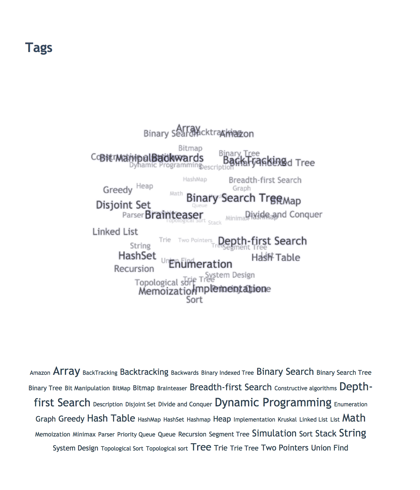

<div align="center">

# hexo-tag-cloud

**为 [Hexo](https://hexo.io/) 打造的 3D 动态标签云，基于 [TagCanvas](https://www.goat1000.com/tagcanvas.php)。**

### [▶ 在线演示](https://d0n9x1n.github.io/hexo-tag-cloud/)

[](https://github.com/D0n9X1n/hexo-tag-cloud/actions/workflows/test.yml)
[](https://github.com/D0n9X1n/hexo-tag-cloud/actions/workflows/release.yml)
[](https://d0n9x1n.github.io/hexo-tag-cloud/)
[](./CLAUDE.md#rules)
<br>
[](https://www.npmjs.com/package/hexo-tag-cloud)
[](https://www.npmjs.com/package/hexo-tag-cloud)
[](https://www.npmjs.com/package/hexo-tag-cloud#provenance)
[](./package.json)
[](https://hexo.io/)
[](./skills/hexo-tag-cloud/SKILL.md)
[](./LICENSE)

[English](./README.md) · 中文



</div>

## 特性

- **适配任意主题**：内置 landscape、NexT、Butterfly、Fluid 配方；`--target` 可写入任意
  EJS / Nunjucks / Swig / Pug / Jade 模板；**注入模式**完全不改模板，连 Icarus 这类 JSX 主题也能用。
- **安全的安装器**：默认只预览 diff；只写入一段带标记的受管代码块；重复执行幂等；
  不会覆盖你手动修改过的内容。
- **Claude Code skill**：[`skills/hexo-tag-cloud/SKILL.md`](./skills/hexo-tag-cloud/SKILL.md)，Claude Code 会先展示 diff，经你确认后再写入。
- **非 ASCII 标签**：自动追加 CJK 字体回退，链接经过百分号编码，中文、日文、韩文、西里尔文标签都能正常显示和跳转。
- **支持子路径部署**：所有 URL 遵循 Hexo 的 `root` 配置，`/blog/` 这类部署可直接使用。

## 快速开始

```bash
# 1. 安装插件（每次构建时生成 js/tagcanvas.js 与 js/tagcloud.js）
npm install hexo-tag-cloud --save

# 2. 把标签云加入主题。第一条命令只预览，加 --apply 才写入
npx hexo-tag-cloud install
npx hexo-tag-cloud install --apply

# 3. 构建
npx hexo clean && npx hexo generate
```

如果主题没有内置配方，或者你不想改模板，可以跳过第 2 步，改为开启注入模式：

```yaml
# _config.yml
tag_cloud:
  inject: true
```

## AI 辅助安装

Claude Code 可以替你完成安装和接线。skill 只有一个文件：
[`skills/hexo-tag-cloud/SKILL.md`](./skills/hexo-tag-cloud/SKILL.md)。把它复制到
`~/.claude/skills/hexo-tag-cloud/`，或者用 CLI 安装：

```bash
npx hexo-tag-cloud install-skill            # 加 --force 可更新旧版本
```

然后对 Claude Code 说 *“给我的 Hexo 博客加一个标签云”*。skill 会先确认插件已安装，再运行
`npx hexo-tag-cloud inspect` 找到主题和模板，然后选择内置配方、`--target` 模板或注入模式。
它会先展示 dry-run 的 diff，经你同意后才写入。详见 [AI-Skill-Usage](./wiki/AI-Skill-Usage.md)。

## 如何使用

### 三种安装方式

| 方式 | 命令 | 是否修改主题文件 | 适用主题 |
|---|---|---|---|
| 内置配方 | `npx hexo-tag-cloud install` | 写入一个受管代码块 | landscape、NexT、Butterfly、Fluid |
| 任意模板 | `npx hexo-tag-cloud install --target <file> --before "</aside>"` | 写入一个受管代码块 | 任意 `.ejs` / `.njk` / `.swig` / `.pug` / `.jade` |
| 注入模式 | 在 `_config.yml` 中设置 `tag_cloud.inject: true` | 不修改 | 所有主题 |

不加 `--apply` 时，所有安装命令都只是预览。运行 `npx hexo-tag-cloud inspect`
可以查看主题目录，以及按“像侧边栏的程度”排序的模板列表。详见 [安装](./wiki/Installation.md)。

### 命令行参数

| 参数 | 默认值 | 作用 |
|---|---|---|
| `--theme <name>` | 读取 `_config.yml` | 指定主题 |
| `--theme-dir <path>` | `themes/<name>`，其次 `node_modules/hexo-theme-<name>` | 主题目录 |
| `--target <file>` | 主题的内置配方 | 任意模板，路径相对于主题目录 |
| `--before <text>` | 追加到文件末尾 | 插入到最后一个包含 `<text>` 的行之前 |
| `--apply` | 关闭（只预览） | 写入修改 |
| `--force` | 关闭 | 覆盖被手动修改过的受管代码块 |
| `--canvas-width` / `--canvas-height` / `--canvas-style` | `250` / `250` / `width: 100%;` | 画布尺寸 |

退出码：`0` 成功或预览 · `1` 无法识别主题、没有配方或模板引擎不受支持 ·
`2` 受管代码块被手动修改过 · `3` 发现旧的手写代码 · `4` 目标文件不存在或无法写入。

### 手写模板

如果要自己写模板，务必把 Hexo 的 `tagcloud()` 放在 canvas **内部**，并通过 `url_for()`
加载两个脚本。EJS 写法如下：

```ejs
<% if (site.tags.length) { %>
<div id="myCanvasContainer" class="widget-wrap tagcloud">
  <canvas id="resCanvas" width="250" height="250" style="width: 100%;">
    <%- tagcloud() %>
  </canvas>
</div>
<script src="<%- url_for('/js/tagcanvas.js') %>"></script>
<script src="<%- url_for('/js/tagcloud.js') %>"></script>
<% } %>
```

## 自定义

```yaml
# _config.yml
tag_cloud:
  textFont: 'Trebuchet MS, Helvetica'  # 只写一个字体时会自动追加 CJK 回退字体
  textColor: '#333'
  textHeight: 25
  outlineColor: '#E2E1D1'
  maxSpeed: 0.5                         # 0.01 – 1
  pauseOnSelected: false                # 高亮某个标签时是否暂停转动
  inject: false                         # true 表示不修改模板（见上文）
  # mount: '#sidebar'                   # 注入模式下的挂载位置：CSS 选择器，按顺序取第一个匹配
```

全部选项和示例配置见 [自定义](./wiki/Customization.md)。

## 文档

- [Wiki 首页](./wiki/Home.md)：[安装](./wiki/Installation.md) ·
  [自定义](./wiki/Customization.md) · [故障排查](./wiki/Troubleshooting.md) ·
  [AI-Skill-Usage](./wiki/AI-Skill-Usage.md) · [贡献指南](./wiki/Contributing.md)
- [从 2.x 升级](./docs/migration-2.x-to-3.x.md)
- [版本发布](https://github.com/D0n9X1n/hexo-tag-cloud/releases)：发布说明列出已解决的 issue 和全部提交

## 反馈

遇到问题或有建议，请到 <https://github.com/D0n9X1n/hexo-tag-cloud/issues> 提交 issue，
并附上 `npx hexo version` 的输出、主题名称、`tag_cloud:` 配置，以及 `npx hexo-tag-cloud inspect` 的输出。

## 许可证

[MIT](./LICENSE)。标签云由 Graham Breach 的 [TagCanvas](https://www.goat1000.com/tagcanvas.php) 绘制。
